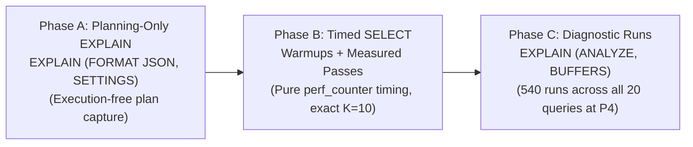

# Precision-Aware Query Planning for Vector Retrieval in PostgreSQL
## Experimental and Reproducibility Protocol

**Document Version:** 2.1.0  
**Target Venue:** IEEE International Conference on Data Engineering (ICDE) / IEEE Transactions on Knowledge and Data Engineering (TKDE)  
**Workspace:** `CompressionAwareRag`  
**Repository Branch:** `research/planner-sensitivity`  
**PostgreSQL Target:** PostgreSQL 18.x with `pgvector` v0.8.0+

---

## 1. Executive Summary & Research Questions

Modern relational database management systems (RDBMS) integrating approximate nearest-neighbor (ANN) vector search rely on cost-based query planners originally designed for scalar B-trees and heap sequential scans. While scalar indexes exhibit low index startup overhead and monotonic selectivity, vector graph indexes—such as Hierarchical Navigable Small World (HNSW) graphs—exhibit distinct storage topologies, iterative graph traversals, and non-linear distance evaluation costs.

In `pgvector` v0.8.4 running on PostgreSQL, physical tuple layout and column storage strategies (`EXTENDED` vs. `PLAIN`) drastically alter heap page counts. Due to heuristic TOAST-adjustment logic in `hnswcostestimate` (`src/hnsw.c:L1228-L1236`), tables with out-of-line TOASTed vectors (e.g., `vector(768)` under default `STORAGE EXTENDED`) receive an artificial startup-cost discount because the main heap page count ($relpages$) drops below the graph's entry-point traversal pages ($startupPages$). In contrast, quantized or inlined vector tables (e.g., `halfvec(768)` or `vector(768)` under `STORAGE PLAIN`) retain larger main heap page counts, preventing this heuristic discount from firing. Consequently, the query planner may elect a brute-force sequential scan with Top-$N$ sort over an HNSW index, or vice-versa, depending on planner cost parameters ($random\_page\_cost$, $cpu\_operator\_cost$).

This protocol defines a rigorous, reproducible framework to investigate:

- **RQ1 (Planner Indifference Frontier):** Under what combinations of $random\_page\_cost \in \{1.0, 4.0, 8.0\}$ and $cpu\_operator\_cost \in \{0.0025, 0.010, 0.050\}$ does PostgreSQL elect a sequential table scan over an available HNSW index scan for vector $K$-NN retrieval ($K=10$)?
- **RQ2 (Representation & Storage Footprint Impact):** How does physical vector layout (`FP32-EXTENDED` vs. `FP32-PLAIN` vs. `FP16-EXTENDED`) shift this indifference frontier across scaling corpus sizes ($N \in \{1{,}001, 5{,}000, 10{,}000\}$ chunks)?
- **RQ3 (Performance & Accuracy Consequences):** What are the empirical latency penalties ($P_{50}, P_{95}$) and Recall@10 trade-offs when the query planner makes a suboptimal retrieval decision compared to forced HNSW execution?

---

## 2. Experimental Data Dictionary & Representation Contrasts

To guarantee zero mutation, table locking, or cache pollution of baseline production and development tables, all experimental tables reside strictly within a dedicated PostgreSQL schema: `planner_sensitivity`.

### 2.1 Database Isolation Matrix

| Catalog / Database Name | Role | Access Policy |
| :--- | :--- | :--- |
| `compression_aware_rag` | Protected baseline catalog (180 chunks) | **STRICT READ-ONLY (DISALLOWED)** |
| `postgres` | Default administrative catalog | **STRICT READ-ONLY (DISALLOWED)** |
| `smart_document_chatbot` | Unrelated project catalog | **STRICT READ-ONLY (DISALLOWED)** |
| `compression_aware_rag_exp` | Scaling experiment catalog ($N=1{,}001$) | **PERMITTED** (schema `planner_sensitivity`) |
| `compression_aware_rag_scale` | Scaling experiment catalog ($N=5{,}000; 10{,}000$) | **PERMITTED** (schema `planner_sensitivity`) |
| `compression_aware_rag_test` | Unit and pilot test catalog | **PERMITTED** (schema `planner_sensitivity`) |

### 2.2 Physical Table Specifications & Scientific Contrasts

For each corpus scale $N \in \{1001, 5000, 10000\}$, three physical tables are populated from identical underlying chunk IDs:

```
planner_sensitivity
 ├── chunks_{scale}_fp32_extended  (vector(768), STORAGE EXTENDED)
 ├── chunks_{scale}_fp32_plain     (vector(768), STORAGE PLAIN)
 └── chunks_{scale}_fp16_extended  (halfvec(768), STORAGE EXTENDED)
```

#### Coordinate Payload Bytes versus Complete Datum Bytes:
- **FP32 (`vector(768)`):**
  - Raw coordinate payload: $768 \times 4 \text{ bytes} = 3{,}072 \text{ bytes}$.
  - Logical datum structure: $3{,}072 + 8 \text{ bytes} = 3{,}080 \text{ bytes}$ (under documented uncompressed $4d + 8$ formula).
  - Empirically measured storage footprint (`pg_column_size`): $3{,}076 \text{ bytes}$ for `FP32 Extended` and $3{,}080 \text{ bytes}$ for `FP32 Plain`. While $3{,}076 \text{ bytes}$ is the recorded physical datum size in PostgreSQL, the precise architectural reason for this 4-byte difference in `FP32 Extended` was not established by the experimental evidence.
  - Out-of-line TOAST threshold: Exceeds the ~2 KiB `TOAST_TUPLE_THRESHOLD` on standard 8 KiB PostgreSQL pages.
- **FP16 (`halfvec(768)`):**
  - Raw coordinate payload: $768 \times 2 \text{ bytes} = 1{,}536 \text{ bytes}$.
  - Logical datum structure: $1{,}536 + 8 \text{ bytes} = 1{,}544 \text{ bytes}$ (under documented $2d + 8$ formula).
  - Empirically measured storage footprint (`pg_column_size`): $1{,}544 \text{ bytes}$.
  - Inline heap storage: Sits comfortably below the 2 KiB threshold, remaining 100% inline within main heap blocks.

#### Scientific Interpretation of Representation Contrasts:

1. **`FP32-EXTENDED` vs. `FP32-PLAIN` (Storage-Policy & Physical-Layout Contrast):**
   - **Mechanism:** In `FP32-EXTENDED`, attributes are stored out-of-line in secondary TOAST relations, leaving lightweight pointer tuples in heap blocks ($relpages \approx 32\text{--}64$ at $N=5{,}000$). In `FP32-PLAIN`, `ALTER TABLE ... SET STORAGE PLAIN` is applied *before* row population, forcing vectors directly into heap blocks (fitting exactly two tuples per 8 KiB page, expanding $relpages \approx 1{,}500\text{--}3{,}000$ at $N=5{,}000$).
   - **Methodological Caution:** This pair compares physical tuple layout and TOAST pointer dereferencing against inline heap storage *without* coordinate quantization. However, physical layout changes also alter page-cache hit patterns and tuple alignment; hence, observed differences reflect combined physical layout consequences rather than an abstract single-variable isolation.
   - **TOAST Accounting:** Allocated TOAST relation size (`pg_relation_size(reltoastrelid)`) reflects page-allocated extents in 8 KiB increments, chunk headers, and extent allocation boundaries, whereas the uncompressed payload equals $N \times 3{,}076$ bytes.

2. **`FP32-PLAIN` vs. `FP16-EXTENDED` (Inline Density & Quantization Contrast):**
   - **Mechanism:** Both representations store embeddings inline in heap blocks (`halfvec(768)` is 1,544 bytes, naturally below the TOAST threshold).
   - **Combined Variables:** Comparing `FP32-PLAIN` and `FP16-EXTENDED` reflects:
     * Datum size (3,080 bytes vs 1,544 bytes per vector).
     * Heap tuple density (2 tuples/page vs 4 tuples/page).
     * HNSW index graph size (~40 MB vs ~20 MB at 10k scale).
     * Distance operation implementation (`vector_cosine_ops` vs `halfvec_cosine_ops`).
     * Quantization noise resulting from IEEE 754 16-bit half-precision conversion.
   - **Attribution Discipline:** Any observed execution-time differences involving `halfvec` should be interpreted as associations with the representation change, not as evidence of a single causal mechanism. The present experiments do not isolate the individual effects of datum size, tuple density, buffer-cache behavior, or distance-operator implementation. Unmeasured hardware claims regarding memory bus saturation or SIMD execution are explicitly disclaimed unless independently isolated via hardware performance counters.

### 2.3 Atomic Fail-Closed Provisioning Workflow
Each scale is provisioned within an isolated transaction (`autocommit=False`) with the following strict execution sequence:
1. **Source Pre-flight**: Verifies source table existence, row count $\ge \text{expected\_count}$, and 768 vector dimensions before any write.
2. **Target State Pre-flight**: Checks for pre-existing tables/indexes; aborts before writing if partial or inconsistent state exists; skips safely only if fully verified across all invariants (row counts, types, dimensions, storage policies, opclasses, valid index status, $m=16, ef\_construction=64$, and chunk parity). Never automatically drops existing objects.
3. **Index Build Memory Configuration**: Sets `SET LOCAL maintenance_work_mem = '512MB';` for the provisioning transaction to ensure in-memory graph construction during index builds (reverts to server default 64MB upon commit or rollback).
4. **Table Creation & Storage Policy**: Creates experimental tables; sets `STORAGE PLAIN` on `fp32_plain` prior to inserting any rows.
5. **Data Population & HNSW Indexing**: Populates exact chunk rows and builds HNSW graph indexes with explicit parameters ($m=16, ef\_construction=64$) and cosine operator classes (`vector_cosine_ops` / `halfvec_cosine_ops`).
6. **In-Transaction Integrity Verification**: Asserts exact row counts, distinct chunk_id uniqueness (`COUNT(DISTINCT chunk_id) == COUNT(*)`), valid single-column `PRIMARY KEY` on `chunk_id`, 100% bidirectional 6-way chunk ID parity, column types and dimensions, storage policies, index validity, and HNSW parameters.
7. **In-Transaction ANALYZE**: Executes `ANALYZE` explicitly on all three newly created experimental tables *inside* the transaction before commit, ensuring optimizer statistics are populated as part of the atomic commit.
8. **Atomic Commit**: `conn.commit()` commits the scale only after all preceding operations succeed. If any step fails (including `ANALYZE`), `conn.rollback()` executes, leaving zero orphan or partial tables.

---

## 3. The 9-Profile Cost Grid & Optimized Execution Matrix

### 3.1 Planner Cost Parameters

PostgreSQL query planning balances estimated sequential page fetches against random page fetches and CPU operations. Cost values are dimensionless arbitrary relative units normalized to $seq\_page\_cost = 1.0$ (the optimizer's arbitrary baseline cost unit). They do not represent an actual physical 8 KiB disk read or measured execution latency:

$$\text{Cost}_{\text{seq}} \approx \text{pages} \times seq\_page\_cost + \text{tuples} \times cpu\_tuple\_cost + \text{tuples} \times cpu\_operator\_cost \quad \text{(Conceptual Model)}$$

We vary $random\_page\_cost \in \{1.0, 4.0, 8.0\}$ and $cpu\_operator\_cost \in \{0.0025, 0.010, 0.050\}$, yielding 9 controlled planner-cost sensitivity settings:

| Profile ID | $random\_page\_cost$ | $cpu\_operator\_cost$ | $seq\_page\_cost$ | $cpu\_tuple\_cost$ | Sensitivity Setting / Configuration Description |
| :--- | :---: | :---: | :---: | :---: | :--- |
| **P1** | 1.0 | 0.0025 | 1.0 | 0.01 | Low random I/O cost setting, pgvector default operator cost (Pilot Forced Profile) |
| **P2** | 1.0 | 0.0100 | 1.0 | 0.01 | Low random I/O cost setting, elevated CPU operator cost |
| **P3** | 1.0 | 0.0500 | 1.0 | 0.01 | Low random I/O cost setting, high CPU operator cost |
| **P4** | 4.0 | 0.0025 | 1.0 | 0.01 | **Canonical Forced Baseline** (PostgreSQL default settings: $rpc=4.0, op=0.0025$) |
| **P5** | 4.0 | 0.0100 | 1.0 | 0.01 | Standard random I/O cost setting, elevated CPU operator cost sensitivity setting |
| **P6** | 4.0 | 0.0500 | 1.0 | 0.01 | Standard random I/O cost setting, high CPU operator cost sensitivity setting |
| **P7** | 8.0 | 0.0025 | 1.0 | 0.01 | High random I/O cost setting, pgvector default operator cost |
| **P8** | 8.0 | 0.0100 | 1.0 | 0.01 | High random I/O cost setting, elevated CPU operator cost |
| **P9** | 8.0 | 0.0500 | 1.0 | 0.01 | High random I/O cost setting, high CPU operator cost |

*Invariant Settings:* `hnsw.ef_search = 40`, `max_parallel_workers_per_gather = 0`, `LIMIT = 10`.

*Methodological Note:* Cost profiles represent controlled planner-cost sensitivity settings, **not** hardware simulations. Claims mapping cost profiles to specific hardware storage tiers (e.g. NVMe, SSD, EBS, HDD, SAN) are explicitly disclaimed.

### 3.2 Matrix Optimization Rationale & Workload Accounting

The planner cost settings $random\_page\_cost$ and $cpu\_operator\_cost$ govern query optimizer path cost estimation; they do *not* alter the executor's physical distance calculation once a forced physical plan (Seq Scan or Index Scan) has been chosen.

Executing all 3 modes across all 9 profiles for measured trials would require:
$$3 \text{ scales} \times 3 \text{ reps} \times 9 \text{ profiles} \times 3 \text{ modes} \times 20 \text{ queries} \times 5 \text{ passes} = 24{,}300 \text{ timed queries}$$

We optimize this matrix by designating **Profile P4** ($random\_page\_cost=4.0, cpu\_operator\_cost=0.0025$, the PostgreSQL standard default baseline) as the documented **canonical cost profile** for forced-path timing (the minimal pilot uses P1):

1. **Planner-Selected Measurements:** Timed across all 9 profiles ($9 \text{ combinations} \times 9 \times 20 \times 5 = \mathbf{8{,}100}$ timed queries).
2. **Forced Exact Measurements:** Timed once per representation-scale combination under canonical profile P4 ($9 \text{ combinations} \times 1 \times 20 \times 5 = \mathbf{900}$ timed queries).
3. **Forced HNSW Measurements:** Timed once per representation-scale combination under canonical profile P4 ($9 \text{ combinations} \times 1 \times 20 \times 5 = \mathbf{900}$ timed queries).
4. **Planning-Only Plan Captures (Execution-Free):** Query plans are captured across all 9 profiles via `EXPLAIN (SETTINGS, FORMAT JSON)` without executing the queries, providing complete cost curves ($9 \times 3 \text{ modes} \times 9 \text{ profiles} \times 20 \text{ queries} = \mathbf{4{,}860}$ plan captures).
5. **Diagnostic EXPLAIN ANALYZE Runs:** Captured for all 20 evaluation queries across all 3 modes under canonical profile P4 ($9 \text{ combinations} \times 3 \text{ modes} \times 20 \text{ queries} = \mathbf{540}$ diagnostic runs).

**Total Timed Executions:** $8{,}100 + 900 + 900 = \mathbf{9{,}900}$ (excluding warm-ups and diagnostics).  
**Total Diagnostic Executions:** $\mathbf{540}$.

The test runner programmatically verifies this workload before execution and **fails closed** if actual timed queries or diagnostic runs differ from the manifest.

---

## 4. Three-Phase Benchmarking Protocol

To guarantee microsecond-accurate physical latency while capturing complete planner cost models and buffer IO diagnostics, execution is separated into three independent phases:



### Phase A: Execution-Free Plan Capture
- **Statement:** `EXPLAIN (SETTINGS, FORMAT JSON) SELECT chunk_id, (embedding <=> %s::{cast}) AS distance FROM {schema}.{table} ORDER BY distance ASC LIMIT %s;`
- **Execution:** Enclosed in `BEGIN READ ONLY; SET LOCAL ...; ... ROLLBACK;`. Evaluates optimizer path selection and cost formulas without executing the query. While it incurs server-side planning and JSON serialization overhead, this overhead is strictly excluded from Phase B SELECT latency measurements.
- **Verification:** For `forced_hnsw` mode, the harness strictly asserts `scan_node_type == "Index Scan"` and `index_name == expected_index_name`.
- **Separation:** GUC settings and plan tree structures are parsed and stored separately from runtime execution diagnostics.

### Phase B: Pure Wall-Clock Latency Measurement
- **Statement:** Parameterized `SELECT chunk_id, (embedding <=> %s::{cast}) AS distance FROM {schema}.{table} ORDER BY distance ASC LIMIT %s;`
- **Prepared-Statement Protection:** All benchmark connections enforce `prepare_threshold=None` on the connection and `prepare=False` on cursor executions. This ensures PostgreSQL freshly plans every query under the active transaction-local cost parameters (`SET LOCAL`), completely preventing Psycopg 3 or PostgreSQL from executing stale prepared statements.
- **Transaction Model:** Fresh transaction with `autocommit=True` wrapping queries in explicit `BEGIN READ ONLY;` and `ROLLBACK;` blocks.
- **Distance Operator:** Uses the `pgvector` cosine distance operator `<=>` (where distance equals $1 - \cos(\theta)$), *not* Euclidean distance (`<->`).
- **Exact Top-K Limit:** Exactly `top_k = 10` is passed as the SQL parameter, fetching strictly 10 rows.
- **Precomputation:** Query vectors are precomputed via Ollama embedding model *prior* to starting the benchmark loop and passed as raw parameters.
- **Timing:** Client-side `time.perf_counter()` bracket immediately surrounding `cur.execute(...)` and `cur.fetchall()`.
- **Randomized Execution Order:** Within each measured pass, trial execution sequence is randomized using a deterministic configurable random seed (default `42`) to mitigate systematic presentation order effects.

### Auxiliary Exact Boundary Tie Detection & Disjoint-Set Recall Formulation
- **Boundary Detection Procedure (`retrieve_boundary_tie_group`):**
  Executed in its own dedicated read-only transaction strictly outside Phase B timing:
  1. Sets `SET LOCAL enable_indexscan = off; SET LOCAL enable_bitmapscan = off; SET LOCAL enable_seqscan = on; SET LOCAL max_parallel_workers_per_gather = 0;`.
  2. Queries the FP32 exact reference table to determine the rank-$K$ boundary distance $D$ (`LIMIT 1 OFFSET top_k - 1`).
  3. Verifies via `EXPLAIN (FORMAT JSON)` that the query plan is strictly `Seq Scan`, failing if an index or approximate path is attempted.
  4. Retrieves all corpus rows with cosine distance $\le D + \max(\tau_{\text{sens}})$ in a single exact sequential scan pass.
  5. Validates that the boundary row is a well-formed tuple with numeric, finite distance (rejects mock fallbacks or malformed container objects).
  6. Constructs mutually disjoint sets of document IDs:
     - $B = \{ c \in \text{Corpus} \mid \text{dist}_{\text{FP32}}(c, q) < D - \tau \}$ (all corpus documents strictly better than boundary).
     - $T = \{ c \in \text{Corpus} \mid |\text{dist}_{\text{FP32}}(c, q) - D| \le \tau \}$ (complete set of documents tied at boundary).
  7. Calculates available boundary slots: $r = \max(0, K - |B|)$.
  8. Identifies crossing boundary ties: `has_boundary_tie` = $(|T| > r)$.

- **Operational Numerical Equivalence Tolerance ($\tau = 1.0 \times 10^{-6}$):**
  - **Predeclared Primary Threshold:** $\tau = 1.0 \times 10^{-6}$.
  - **Justification:** Serves as an operational numerical-equivalence threshold for identifying boundary distance ties across 768-dimensional vector dot-product and norm accumulations under hardware floating-point math. It is documented explicitly as an **operational convention** for tie handling, and is not a mathematically proven universal IEEE-754 error bound.
  - **Robustness Sensitivity Analysis:** Evaluated across three distinct thresholds: $\tau \in \{1.0 \times 10^{-7}, 1.0 \times 10^{-6}, 1.0 \times 10^{-5}\}$ from the same retrieved FP32 distance values without redundant database scans. Both primary and sensitivity thresholds are recorded in manifest metadata.

- **Dual Recall Formulation:**
  Let $S$ be the candidate top-$K$ document IDs retrieved by any tested mode or representation ($|S| \le K$):
  1. **Conventional Recall@10 (Primary Benchmark Accuracy Metric):**
     $$\text{Recall@10}_{\text{conv}} = \frac{|S \cap \text{Top-K}_{\text{ref}}|}{K}$$
     *Limitation:* Arbitrary tie-breaking (e.g. tuple ID ordering) at rank 10 vs 11 in ground truth unfairly penalizes candidate queries that return an equally distant alternative.
  2. **Tie-Aware Recall@10 (Auxiliary Discrepancy Metric):**
     $$\text{Recall@10}_{\text{tie\_aware}} = \frac{|S \cap B| + \min(|S \cap T|, r)}{K}$$
     *Disjoint-Set Proof:* Since $B \cap T = \emptyset$ by definition, $(S \cap B)$ and $(S \cap T)$ are strictly disjoint subsets of $S$, mathematically eliminating any possibility of double-counting.
     *Upper Bound:* Since $|S \cap B| \le |B| = K - r$ and $\min(|S \cap T|, r) \le r$, the numerator is bounded by $(K - r) + r = K$, guaranteeing that $\text{Recall@10}_{\text{tie\_aware}} \le 1.0$.
     *FP16 Quantization Insulation:* Membership of candidate documents in $B$ and $T$ is determined strictly from FP32 reference distances, preventing halfvec quantization error from corrupting tie evaluation.

### Phase C: Diagnostic Buffer Inspection & Completeness Accounting
- **Statement:** `EXPLAIN (ANALYZE, BUFFERS, SETTINGS, FORMAT JSON) SELECT ...;`
- **Coverage:** Executed across all 20 evaluation queries for all 3 modes under canonical profile P4 (540 total diagnostic executions).
- **Buffer Aggregation Model:** In PostgreSQL EXPLAIN JSON plans, parent nodes report cumulative buffer counters including their children. To determine total query buffer usage, the parser extracts the top-level root plan node counters directly (`Shared Hit Blocks`, `Shared Read Blocks`, `Shared Dirtied Blocks`, `Shared Written Blocks`), avoiding recursive child accumulation.
- **Sequencing:** Executed strictly *after* Phase B timed SELECT queries have concluded.
- **Runtime Completeness Accounting:** Tracks `expected`, `attempted`, `successful`, and `failed` executions.
  - Every attempt writes an explicit JSON line to `diagnostic_results.jsonl`, including errors with `error_message`.
  - If any diagnostic fails, the manifest explicitly records `diagnostic_accounting.dataset_status = "incomplete"`.
  - The primary latency benchmark remains separately tracked and identifiable.

---

## 5. Statistical & Methodological Discipline

1. **Planner Costs vs. Physical Latency & I/O:** PostgreSQL query planner costs are dimensionless arbitrary relative units (normalized relative to $seq\_page\_cost = 1.0$) representing the optimizer's heuristic estimate of I/O and CPU work. They must **never** be equated with physical execution time in milliseconds or an actual physical 8 KiB disk read.
2. **Pilot Scale Boundaries:** Small-corpus pilots (e.g. 180 chunks) serve exclusively as functional smoke-tests to verify harness mechanics, schema isolation, and parser fidelity. They must **not** be extrapolated to predict 1,001, 5,000, or 10,000-chunk scaling dynamics.
3. **Sample Size Limitations in Pilots:** While IQR and P95 formulas are computed programmatically, calculating percentiles on a sample size of $N=4$ observations (2 queries × 2 passes) has no statistical significance and serves only to verify arithmetic pipeline schema. Meaningful distribution analysis requires the full multi-pass dataset.
4. **Recall Fidelity at Scale:** Achieving Recall@10 = 1.0 on 2 queries in a 180-chunk corpus demonstrates only that the search algorithm found the top candidates in a small graph, not that quantization or HNSW approximation maintains 100% recall on 10,000-vector graphs.
5. **Variance Categorization:** A strict distinction is maintained between query-level variance (inherent difficulty across distinct semantic queries and vector neighborhoods) and execution-level variance (operating system page cache warming, memory bus jitter across repeated executions of the same query).

---

## 6. Step-by-Step Reproducibility Guide

### Step 1: Environment & Dependency Verification
```bash
# Verify PostgreSQL and pgvector availability
psql -U postgres -d compression_aware_rag_scale -c "SELECT extversion FROM pg_extension WHERE extname = 'vector';"

# Run full test suite (120 tests)
pytest -v
```

### Step 2: Experimental Schema Provisioning & Readiness Verification
```bash
# Provision isolated experimental tables with atomic transaction-per-scale guarantees
python scripts/provision_planner_sensitivity.py --scale 1001 --scale 5000 --scale 10000 --apply

# Perform strictly read-only pre-flight inspection of table readiness, row counts, types, opclasses, and indexes
python scripts/verify_table_readiness.py --scale all
```

### Step 3: Minimal Live Acceptance Pilot (Smoke Test)
```bash
# Smoke test on compression_aware_rag_test (P1 and P9, 2 queries, 2 warmups, 2 passes)
python src/planner_sensitivity_experiment.py --pilot
```

### Step 4: Full Multi-Profile Research Execution (9,900 Timed Queries, 540 Diagnostics)
```bash
# Full execution across all scales and profiles under canonical profile P4
python src/planner_sensitivity_experiment.py --scale all --representation all --canonical-profile P4 --warmup-passes 2 --measured-passes 5 --random-seed 42 --output-dir results/planner_sensitivity/full_run_<id>
```

### Step 5: Research Analysis & Provenance Verification
```bash
# Execute comprehensive statistical analysis & non-parametric tests (offline)
python scripts/analysis/analyze_phase3_sensitivity.py

# Execute boundary-tie tolerance sensitivity audit (read-only DB)
python scripts/analysis/run_phase3a_tie_sensitivity.py

# Execute evidence chain closure & GUC equivalence audit (read-only DB)
python scripts/analysis/run_phase3a_addendum_closure.py
```
