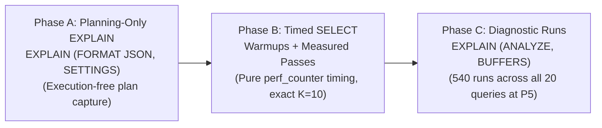

# Precision-Aware Query Planning for Vector Retrieval in PostgreSQL
## Experimental and Reproducibility Protocol

**Document Version:** 1.4.0  
**Target Venue:** IEEE International Conference on Data Engineering (ICDE) / IEEE Transactions on Knowledge and Data Engineering (TKDE)  
**Workspace:** `CompressionAwareRag`  
**Repository Branch:** `research/planner-sensitivity`  
**PostgreSQL Target:** PostgreSQL 18.x with `pgvector` v0.8.4+

---

## 1. Executive Summary & Research Questions

Modern relational database management systems (RDBMS) integrating approximate nearest-neighbor (ANN) vector search rely on cost-based query planners originally designed for scalar B-trees and heap sequential scans. While scalar indexes exhibit low index startup overhead and monotonic selectivity, vector graph indexes—such as Hierarchical Navigable Small World (HNSW) graphs—exhibit distinct storage topologies, iterative graph traversals, and non-linear distance evaluation costs.

In `pgvector` v0.8.4 running on PostgreSQL, physical tuple layout and column storage strategies (`EXTENDED` vs. `PLAIN`) drastically alter heap page counts. Due to heuristic TOAST-adjustment logic in `hnswcostestimate` (`src/hnsw.c:L1228-L1236`), tables with out-of-line TOASTed vectors (e.g., `vector(768)` under default `STORAGE EXTENDED`) receive an artificial startup-cost discount because the main heap page count ($relpages$) drops below the graph's entry-point traversal pages ($startupPages$). In contrast, quantized or inlined vector tables (e.g., `halfvec(768)` or `vector(768)` under `STORAGE PLAIN`) retain larger main heap page counts, preventing this heuristic discount from firing. Consequently, the query planner may erroneously select a brute-force sequential scan with Top-$N$ sort over an HNSW index, or vice-versa, depending on planner cost parameters ($random\_page\_cost$, $cpu\_operator\_cost$).

This protocol defines a rigorous, reproducible framework to investigate:

- **RQ1 (Planner Indifference Frontier):** Under what combinations of $random\_page\_cost \in \{1.0, 4.0, 8.0\}$ and $cpu\_operator\_cost \in \{0.0025, 0.010, 0.050\}$ does PostgreSQL 18 elect a sequential table scan over an available HNSW index scan for vector $K$-NN retrieval ($K=10$)?
- **RQ2 (Representation & Storage Footprint Impact):** How does physical vector layout (`FP32-EXTENDED` vs. `FP32-PLAIN` vs. `FP16-EXTENDED`) shift this indifference frontier across scaling corpus sizes ($N \in \{1{,}001, 5{,}000, 10{,}000\}$ chunks)?
- **RQ3 (Performance & Accuracy Consequences):** What are the empirical latency penalties ($P_{50}, P_{95}$) and Recall@10 trade-offs when the query planner makes a suboptimal retrieval decision compared to forced HNSW execution?

---

## 2. Experimental Data Dictionary & Representation Contrasts

To guarantee zero mutation, table locking, or cache pollution of baseline production and development tables, all experimental tables reside strictly within a dedicated PostgreSQL schema: `planner_sensitivity`.

### 2.1 Database Isolation Matrix

| Catalog / Database Name | Role | Access Policy |
| :--- | :--- | :--- |
| `compression_aware_rag` | Production / Review 2 baseline (180 chunks) | **STRICT READ-ONLY (DISALLOWED)** |
| `postgres` | Default administrative catalog | **STRICT READ-ONLY (DISALLOWED)** |
| `smart_document_chatbot` | Unrelated project catalog | **STRICT READ-ONLY (DISALLOWED)** |
| `compression_aware_rag_exp` | Scaling experiment catalog ($N=1{,}001$) | **PERMITTED** (schema `planner_sensitivity`) |
| `compression_aware_rag_scale` | Scaling experiment catalog ($N=5{,}000; 10{,}000$) | **PERMITTED** (schema `planner_sensitivity`) |
| `compression_aware_rag_test` | Unit and pilot test catalog | **PERMITTED** (schema `planner_sensitivity`) |

### 2.2 Physical Table Specifications & Scientific Contrasts

For each corpus scale $N \in \{1001, 5000, 10000\}$, three physical tables are populated from identical underlying chunk IDs:

```
planner_sensitivity
 ├── chunks_{scale}_fp32_extended  (vector(768), STORAGE EXTENDED)
 ├── chunks_{scale}_fp32_plain     (vector(768), STORAGE PLAIN)
 └── chunks_{scale}_fp16_extended  (halfvec(768), STORAGE EXTENDED)
```

#### Scientific Interpretation of Representation Contrasts:

1. **`FP32-EXTENDED` vs. `FP32-PLAIN` (Storage-Policy & Heap/TOAST Contrast):**
   - **Mechanism:** In `FP32-EXTENDED`, 3,076-byte `vector(768)` attributes exceed PostgreSQL's tuple threshold and are automatically moved out-of-line into external TOAST tables. The main heap relation contains only lightweight pointer tuples ($relpages \approx 32\text{--}64$ for $N=5{,}000$). In `FP32-PLAIN`, `ALTER TABLE ... ALTER COLUMN embedding SET STORAGE PLAIN` is applied *before* row ingestion, strictly forbidding out-of-line storage and forcing vectors directly into heap blocks (fitting exactly two tuples per 8 KiB page, expanding $relpages \approx 1{,}500\text{--}3{,}000$ for $N=5{,}000$).
   - **Isolation:** This pair isolates the pure cost-model and physical-layout effects of TOAST table dereferencing versus inline heap scanning *without* introducing vector quantization or precision loss.
   - **TOAST Accounting:** Allocated TOAST relation size (`pg_relation_size(reltoastrelid)`) reflects page-allocated extents (in 8 KiB increments) including chunk-header overhead and fragmentation, whereas vector payload equals $N \times 3{,}076$ bytes.

2. **`FP32-PLAIN` vs. `FP16-EXTENDED` (Inline Density & Quantization Contrast):**
   - **Mechanism:** Both representations store their vectors inline in heap blocks (`halfvec(768)` is 1,536 bytes, naturally below the 2,048-byte TOAST threshold).
   - **Isolation:** Comparing `FP32-PLAIN` and `FP16-EXTENDED` isolates the combined effects of:
     * Datum size (3,076 bytes vs 1,536 bytes per vector).
     * Heap tuple density (2 tuples/page vs 4 tuples/page).
     * Index footprint (e.g., 728 KiB vs 368 KiB at pilot scale; ~40 MB vs ~20 MB at 10k scale).
     * Distance operation implementation (`vector_cosine_ops` vs `halfvec_cosine_ops`).
     * Quantization noise resulting from IEEE 754 16-bit half-precision conversion.
   - **Attribution Discipline:** Any execution speedup observed in `halfvec` operations stems primarily from reduced memory bus bandwidth, higher buffer cache page density, and reduced index graph size. While modern CPU architectures feature SIMD instruction sets (e.g. AVX2/AVX-512), no claim is made that FP16 speedup is caused by SIMD unless independently isolated via hardware instruction counters.

---

## 3. The 9-Profile Cost Grid & Optimized Execution Matrix

### 3.1 Planner Cost Parameters

PostgreSQL query planning balances sequential page reads against random page reads and CPU operations:

$$\text{Cost}_{\text{seq}} = \text{pages} \times seq\_page\_cost + \text{tuples} \times cpu\_tuple\_cost + \text{tuples} \times cpu\_operator\_cost$$

We vary $random\_page\_cost$ across 3 storage tiers and $cpu\_operator\_cost$ across 3 CPU processing tiers ($3 \times 3 = 9$ profiles):

| Profile ID | $random\_page\_cost$ | $cpu\_operator\_cost$ | $seq\_page\_cost$ | $cpu\_tuple\_cost$ | Intended Hardware Analogy |
| :--- | :---: | :---: | :---: | :---: | :--- |
| **P1** | 1.0 | 0.0025 | 1.0 | 0.01 | All-NVMe SSD, fast vectorized CPU (pgvector default $cpu\_operator\_cost$) |
| **P2** | 1.0 | 0.0100 | 1.0 | 0.01 | Fast NVMe SSD, balanced general-purpose CPU |
| **P3** | 1.0 | 0.0500 | 1.0 | 0.01 | Fast NVMe SSD, compute-bound / high CPU overhead |
| **P4** | 4.0 | 0.0025 | 1.0 | 0.01 | Managed cloud disk (gp3 / EBS), fast CPU |
| **P5** | 4.0 | 0.0100 | 1.0 | 0.01 | **Canonical Default Baseline** (standard PostgreSQL defaults) |
| **P6** | 4.0 | 0.0500 | 1.0 | 0.01 | Managed cloud disk, compute-bound / high CPU overhead |
| **P7** | 8.0 | 0.0025 | 1.0 | 0.01 | Legacy HDD / high-latency remote storage, fast CPU |
| **P8** | 8.0 | 0.0100 | 1.0 | 0.01 | Legacy HDD, balanced CPU |
| **P9** | 8.0 | 0.0500 | 1.0 | 0.01 | Legacy HDD, high CPU overhead |

*Invariant GUCs:* `hnsw.ef_search = 40`, `max_parallel_workers_per_gather = 0`, `LIMIT = 10`.

### 3.2 Matrix Optimization Rationale & Workload Accounting

The planner cost settings `random_page_cost` and `cpu_operator_cost` govern query optimizer path cost estimation; they do *not* alter the executor's physical distance calculation once a forced physical plan (Seq Scan or Index Scan) has been chosen.

Executing all 3 modes across all 9 profiles for measured trials would require:
$$3 \text{ scales} \times 3 \text{ reps} \times 9 \text{ profiles} \times 3 \text{ modes} \times 20 \text{ queries} \times 5 \text{ passes} = 24{,}300 \text{ timed queries}$$

We optimize this matrix by designating **Profile P5** ($random\_page\_cost=4.0, cpu\_operator\_cost=0.010$) as the documented **canonical cost profile** for forced-path timing:

1. **Planner-Selected Measurements:** Timed across all 9 profiles ($9 \text{ combinations} \times 9 \times 20 \times 5 = \mathbf{8{,}100}$ timed queries).
2. **Forced Exact Measurements:** Timed once per representation-scale combination under canonical profile P5 ($9 \text{ combinations} \times 1 \times 20 \times 5 = \mathbf{900}$ timed queries).
3. **Forced HNSW Measurements:** Timed once per representation-scale combination under canonical profile P5 ($9 \text{ combinations} \times 1 \times 20 \times 5 = \mathbf{900}$ timed queries).
4. **Planning-Only Plan Captures (Execution-Free):** Query plans are captured across all 9 profiles via `EXPLAIN (SETTINGS, FORMAT JSON)` without executing the queries, providing complete cost curves ($9 \times 3 \text{ modes} \times 9 \text{ profiles} \times 20 \text{ queries} = \mathbf{4{,}860}$ plan captures).
5. **Diagnostic EXPLAIN ANALYZE Runs:** Captured for all 20 evaluation queries across all 3 modes under canonical profile P5 ($9 \text{ combinations} \times 3 \text{ modes} \times 20 \text{ queries} = \mathbf{540}$ diagnostic runs).

**Total Timed Executions:** $8{,}100 + 900 + 900 = \mathbf{9{,}900}$ (excluding warm-ups and diagnostics).  
**Total Diagnostic Executions:** $\mathbf{540}$.

The test runner programmatically verifies this workload before execution and **fails closed** if actual timed queries or diagnostic runs differ from the manifest.

---

## 4. Three-Phase Benchmarking Protocol

To guarantee microsecond-accurate physical latency while capturing complete planner cost models and buffer IO diagnostics, execution is separated into three independent phases:



### Phase A: Execution-Free Plan Capture
- **Statement:** `EXPLAIN (SETTINGS, FORMAT JSON) SELECT chunk_id, (embedding <=> %s::{cast}) AS distance FROM {schema}.{table} ORDER BY distance ASC LIMIT %s;`
- **Execution:** Enclosed in `BEGIN READ ONLY; SET LOCAL ...; ... ROLLBACK;`. Evaluates optimizer path selection and cost formulas without executing the query. While it incurs server-side planning and JSON serialization overhead, this overhead is strictly excluded from Phase B SELECT latency measurements.
- **Verification:** For `forced_hnsw` mode, the harness strictly asserts `scan_node_type == "Index Scan"` and `index_name == expected_index_name`.
- **Separation:** GUC settings and plan tree structures are parsed and stored separately from runtime execution diagnostics.

### Phase B: Pure Wall-Clock Latency Measurement
- **Statement:** Parameterized `SELECT chunk_id, (embedding <=> %s::{cast}) AS distance FROM {schema}.{table} ORDER BY distance ASC LIMIT %s;`
- **Distance Operator:** Uses the `pgvector` cosine distance operator `<=>` (where distance equals $1 - \cos(\theta)$), *not* Euclidean distance (`<->`).
- **Exact Top-K Limit:** Exactly `top_k = 10` is passed as the SQL parameter, fetching strictly 10 rows.
- **Precomputation:** Query vectors are precomputed via Ollama embedding model *prior* to starting the benchmark loop and passed as raw parameters.
- **Timing:** Client-side `time.perf_counter()` bracket immediately surrounding `cur.execute(...)` and `cur.fetchall()`.
- **Randomized Execution Order:** Within each measured pass, trial execution sequence is randomized using a deterministic configurable random seed (default `42`) to mitigate systematic ordering effects (such as presentation order and sequential cache warming effects). Note that randomization mitigates systematic trial presentation bias across representations and profiles, but does *not* eliminate underlying hardware, OS, or buffer cache effects (which are separately controlled via warmup passes and buffer accounting).

### Auxiliary Exact Boundary Tie Detection & Disjoint-Set Recall Formulation
- **Boundary Detection Procedure (`retrieve_boundary_tie_group`):**
  Executed in its own dedicated read-only transaction strictly outside Phase B timing:
  1. Sets `SET LOCAL enable_indexscan = off; SET LOCAL enable_bitmapscan = off; SET LOCAL enable_seqscan = on; SET LOCAL max_parallel_workers_per_gather = 0;`.
  2. Queries the FP32 exact reference table to determine the rank-$K$ boundary distance $D$ (`LIMIT 1 OFFSET top_k - 1`).
  3. Verifies via `EXPLAIN (FORMAT JSON)` that the query plan is strictly `Seq Scan`, failing if an index or approximate path is attempted.
  4. Retrieves all corpus rows with cosine distance $\le D + \tau$ where $\tau = 1.0 \times 10^{-6}$.
  5. Constructs mutually disjoint sets of document IDs:
     - $B = \{ c \in \text{Corpus} \mid \text{dist}_{\text{FP32}}(c, q) < D - \tau \}$ (all corpus documents strictly better than boundary).
     - $T = \{ c \in \text{Corpus} \mid |\text{dist}_{\text{FP32}}(c, q) - D| \le \tau \}$ (complete set of documents tied at boundary).
  6. Calculates available boundary slots: $r = K - |B|$.
  7. Identifies crossing boundary ties: `has_boundary_tie` = $(|T| > r)$.

- **Single Numerical Tolerance Policy ($\tau = 1.0 \times 10^{-6}$):**
  - Applied uniformly across boundary detection, set construction of $B$ and $T$, recall evaluation, metadata manifests, and unit tests.
  - *Technical Justification:* Vectors are stored as IEEE 754 single-precision floats (24-bit significand, machine epsilon $\approx 1.19 \times 10^{-7}$). Accumulating dot products and Euclidean norms across 768 dimensions yields floating-point rounding error on the order of $\sqrt{768} \times \epsilon_{\text{fp32}} \approx 3.3 \times 10^{-6}$. A tolerance threshold of $\tau = 1.0 \times 10^{-6}$ is sufficiently wide to absorb float rounding artifacts without conflating distinct semantic vector neighborhoods (which typically exhibit $\Delta \ge 10^{-4}$).
  - *Philosophical Distinction:* We explicitly classify this threshold as **approximate numerical equivalence within floating-point rounding bounds**, not mathematically exact real equality.

- **Dual Recall Formulation:**
  Let $S$ be the candidate top-$K$ document IDs retrieved by any tested mode or representation ($|S| \le K$):
  1. **Conventional Recall@10 (Primary Benchmark Accuracy Metric):**
     $$\text{Recall@10}_{\text{conv}} = \frac{|S \cap \text{Top-K}_{\text{ref}}|}{K}$$
     *Limitation:* Arbitrary tie-breaking (e.g. tuple ID ordering) at rank 10 vs 11 in ground truth unfairly penalizes candidate queries that return an equally distant alternative.
  2. **Tie-Aware Recall@10 (Auxiliary Discrepancy Metric):**
     $$\text{Recall@10}_{\text{tie\_aware}} = \frac{|S \cap B| + \min(|S \cap T|, r)}{K}$$
     *Disjoint-Set Proof:* Since $B \cap T = \emptyset$ by definition, $(S \cap B)$ and $(S \cap T)$ are strictly disjoint subsets of $S$, mathematically eliminating any possibility of double-counting.
     *Upper Bound:* Since $|S \cap B| \le |B| = K - r$ and $\min(|S \cap T|, r) \le r$, the numerator is bounded by $(K - r) + r = K$, guaranteeing that $\text{Recall@10}_{\text{tie\_aware}} \le 1.0$.
     *FP16 Quantization Insulation:* Membership of candidate documents in $B$ and $T$ is determined strictly from FP32 reference distances, preventing halfvec quantization error from corrupting tie evaluation.

### Phase C: Diagnostic Buffer Inspection & Completeness Accounting
- **Statement:** `EXPLAIN (ANALYZE, BUFFERS, SETTINGS, FORMAT JSON) SELECT ...;`
- **Coverage:** Executed across all 20 evaluation queries for all 3 modes under canonical profile P5 (540 total diagnostic executions).
- **Sequencing:** Executed strictly *after* Phase B timed SELECT queries have concluded.
- **Runtime Completeness Accounting:** Tracks `expected`, `attempted`, `successful`, and `failed` executions.
  - Every attempt writes an explicit JSON line to `diagnostic_results.jsonl`, including errors with `error_message`.
  - If any diagnostic fails, the manifest explicitly records `diagnostic_accounting.dataset_status = "incomplete"`.
  - The primary latency benchmark remains separately tracked and identifiable.

---

## 5. Statistical & Methodological Discipline

1. **Planner Costs vs. Physical Latency:** PostgreSQL query planner costs are dimensionless arbitrary relative units (normalized relative to $seq\_page\_cost = 1.0$) representing the optimizer's heuristic estimate of I/O and CPU work. They must **never** be conflated with physical execution time in milliseconds.
2. **Pilot Scale Boundaries:** Small-corpus pilots (e.g. 180 chunks) serve exclusively as functional smoke-tests to verify harness mechanics, schema isolation, and parser fidelity. They must **not** be extrapolated to predict 1,001, 5,000, or 10,000-chunk scaling dynamics.
3. **Sample Size Limitations in Pilots:** While IQR and P95 formulas are computed programmatically, calculating percentiles on a sample size of $N=4$ observations (2 queries × 2 passes) has no statistical significance and serves only to verify arithmetic pipeline schema. Meaningful distribution analysis requires the full multi-pass dataset.
4. **Recall Fidelity at Scale:** Achieving Recall@10 = 1.0 on 2 queries in a 180-chunk corpus demonstrates only that the search algorithm found the top candidates in a small graph, not that quantization or HNSW approximation maintains 100% recall on 10,000-vector graphs.
5. **Variance Categorization:** A strict distinction is maintained between query-level variance (inherent difficulty across distinct semantic queries and vector neighborhoods) and execution-level variance (operating system page cache warming, memory bus jitter across repeated executions of the same query).

---

## 6. Step-by-Step Reproducibility Guide

### Step 1: Environment & Dependency Verification
```bash
# Verify PostgreSQL and pgvector availability
psql -U postgres -d compression_aware_rag_scale -c "SELECT extversion FROM pg_extension WHERE extname = 'vector';"

# Run full test suite (78 tests)
pytest -v
```

### Step 2: Experimental Schema Provisioning & Readiness Verification
```bash
# Provision isolated experimental tables, set STORAGE PLAIN, build HNSW indexes, and analyze
python scripts/provision_planner_sensitivity.py --scale 1001 --scale 5000 --scale 10000 --apply

# Perform strictly read-only pre-flight inspection of table readiness, row counts, and indexes
python scripts/verify_table_readiness.py --scale all
```

### Step 3: Minimal Live Acceptance Pilot (Smoke Test)
```bash
# Smoke test on compression_aware_rag_test (P1 and P9, 2 queries, 2 warmups, 2 passes)
python src/planner_sensitivity_experiment.py --pilot
```

### Step 4: Full Multi-Profile Research Execution (9,900 Timed Queries, 540 Diagnostics)
```bash
python src/planner_sensitivity_experiment.py --scale all --representation all --canonical-profile P5 --passes 5 --warmup 2
```
